

# TMTK Source Code — Tecno · Infinix · iTel — META Mode + SPD

**TMTK v2.0** — a Windows desktop tool for MediaTek *META mode* bootloader work and Unisoc *SPD* service work.

**TFAST Digital Agency**

[🌐 Website](https://tfastdigital.com/) · [📢 Telegram](https://t.me/tfasthub) · [💬 WhatsApp +256 751 399 620](https://wa.me/256751399620)

---

## 📄 What this repository is

This is the **public information page** for TMTK v2.0. It explains what the tool does, how the logic
is laid out, which device tokens are supported, and how the safety rules behave.

> **This repository does not contain the TMTK source code, and it does not contain release binaries.**
> Nothing here can flash, unlock or modify a phone. Everything on this page is documentation.

| This repository | Not in this repository |
|---|---|
| Feature overview, screenshots and the demo shell | `TMTK.exe` / installers |
| How the analysis engines are structured | C# / XAML source files |
| The full supported-model matrix | Private keys, certificates, key material |
| Status and evidence rules | Loaders, PAC files, vendor firmware |
| Support and model-request channels | Any device write path |

---

## 🕹️ Try the demo shell

**→ [`demo/index.html`](demo/index.html)**

Open that file directly in a browser, or enable GitHub Pages and visit `/demo/` (steps in
[`demo/README.md`](demo/README.md)). No install, no build step, works offline.

It is a **mock-up**: the interface, the states and the feel of the tool, with nothing behind it. You can
press Connect, walk the partition table, run the bootloader analysis (it ends in the refusal, because
that is what the real build does on a 32-bit bootloader), and click any model token to see every engine
that claims it.

> The demo shell contains **no product code**. No WebSerial/WebUSB, no protocol bytes, no keys, no
> `fetch`, no file writes. Its only four requests are its own four files — check DevTools. Anything that
> would write to a device is inert and says so.

Built this way on purpose: a demo that can flash a phone is not a demo, and a demo that invents success
states would contradict everything else on this page. See [`demo/README.md`](demo/README.md) for the
fixture sources and the rules for changing it.

---

## ⚡ What TMTK does

TMTK is one desktop application with **two independent engines**. They share a UI, an event log and a
backup system — nothing else. You pick the engine that matches the phone in your hand.

### 🟦 META engine — MediaTek

META mode runs *instead of* the normal boot path, so the bootloader's own lock check never executes.
That is why a locked, non-rooted device can still have its bootloader partition read and, when the
exact lock store is recognised, patched and verified.

* **LAN / META channel** to a MediaTek handset
* **GPT partition work** — list, read and write partitions, byte-exact verified
* **Bootloader (LK) analysis** — architecture, identity and lock-store discovery, done offline on the image
* **Branch-aware method selection** — one method per device class, chosen by what the image actually contains
* **System backup** with SHA-256 manifests before anything is written
* **Live speed/throughput meter**, because META is slow and pretending otherwise wastes your day

### 🟨 SPD engine — Unisoc (Spreadtrum) — **in active development**

🟢 **Working today (offline, file-side):**

* **Device detection** — vendor/mode classification, `spd-diag` vs `spd-download`
* **PAC archive support** — inspect, plan and extract `BP_R1` / `BP_R2` containers byte-exactly
* **FDL kit inspection** — recognises an FDL1/FDL2 pair by name and size, prints SHA-256 of each file
* **Partition manager view** — the operator picks the layout; the tool never guesses on your behalf
* **Model matrix coverage** for AUTO BL, FDL unlock and SoC/partition work

🟡 **In progress:**

* Unisoc BROM → FDL1 → FDL2 transport
* Partition map read / write over that transport
* AUTO BL and FDL unlock recipe pairing

> ⚠️ **Where the SPD lane stands:** it is **under active development**, and more is being added.
> The offline half is real and tested — the PAC *container* is solved, byte-exactly. The *protocol* is
> not: there is no BROM/FDL transport yet, so the SPD model lists are **data**, not a working flush path.
> The tool says which half you are in instead of faking a green tick.
> See [`docs/HOW-IT-WORKS.md`](docs/HOW-IT-WORKS.md) → *The SPD lane, honestly*.

---

## 🧠 How it works — 60 seconds

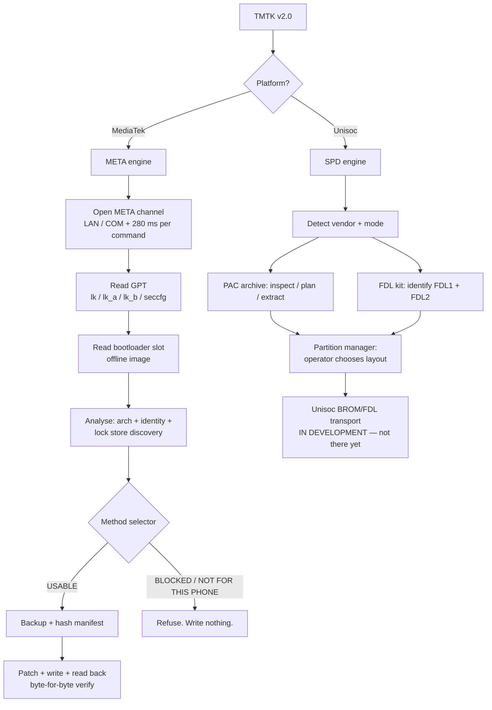

The shape of the whole program is the same on both sides:

1. **Read** the device or the file — never assume a layout.
2. **Identify** exactly what you are looking at.
3. **Refuse** when anything is ambiguous, incomplete or unrecognised.
4. Only then **write**, with a backup and a read-back comparison behind it.

### The refusal is the feature

A wrong engine pick is what kills a phone. TMTK is built so that the *default* answer to an unclear
situation is **"I will not write"**, and the reason is printed with the exact artifact that would
unblock it.

Full breakdown: [`docs/HOW-IT-WORKS.md`](docs/HOW-IT-WORKS.md)

---

## 📋 TMTK v2.0 — supported model matrix

**53 tokens · 4 lists · TFAST Digital Agency**

### 🟦 MTK — LK file patch (18)

| | | | |
|---|---|---|---|
| CM5 Camon 40 | CM6 Camon 40 Pro | X6880 Infinix | X6886 Hot 60 Pro Plus |
| KL5 Spark 30 C | KM5 | KM6 Spark 40 Pro | KM7 Spark 40 Pro Plus |
| CK6 | CK7 | CL6 | CLA5 Camon 30s |
| KL7 | X6728B | KM4 Pop 10 | A100 |
| X6725 | X6725B | | |

### 🟦 MTK — ready bootloader

Same **18 tokens**, second operation. No separate list was recovered — the two MTK operations cover the
same device set.

### 🟨 SPD — AUTO BL / uboot + vbmeta (12)

| | | |
|---|---|---|
| X6725B | X6526D_V2506 (X6525D V2506) | X6725 |
| X6525 Smart 8 | A6610L itel A90 | A666L itel A70 |
| BG6 Pop 8 | BG6M | KM4 Pop 10 |
| KL4 Pop 9 | KN3_AUG Pop 20 — Aug patch | KN3_FEB Pop 20 — Feb patch |

### 🟨 SPD — FDL / EDL unlock (12)

| | | |
|---|---|---|
| KM6 Spark 40 Pro | KM7 Spark 40 Pro Plus | CM5 Camon 40 |
| CM6 Camon 40 Pro | CLA5 Camon 30s | X6886 Hot 60 Pro Plus |
| X6885 Hot 60 Pro | KL5 Spark 30 C | X6880 |
| X6853 | X6850 | X6851 |

### 🟨 SPD — partition manager / PAC (11)

| | | |
|---|---|---|
| SC9863A | SC9863A_64 | TIGER_T615 |
| TIGER_T616 | M-KOPA S34 | SC9863A-ITEL-VISION3 |
| SC9863A-ZTE-BLADE-A31 | UMS9230 (eMMC) | UMS9230-UFS |
| UMS9620-DRAMTYPE1 | UMS9620-DRAMTYPE2 | |

---

### 🔁 11 tokens are claimed by more than one engine

`CM5` · `CM6` · `KM4` · `KM6` · `KM7` · `KL5` · `CLA5` · `X6880` · `X6886` · `X6725` · `X6725B`

The tool shows **every** engine that claims a token and makes you choose.

> **It never picks for you — a wrong pick is what kills a phone.**

### 🔍 Storage type is part of identity

`UMS9230 (eMMC)` is **not** `UMS9230-UFS`. Different storage controller, different 512 vs 4096-byte
logical sector size, different partition layout. The same applies to `UMS9620` DRAM type 1 vs type 2.

Some recipes are not keyed to a model name at all:

| Recipe is keyed to | Example |
|---|---|
| Model token | `BG6`, `X6850` |
| Model **+ security patch month** | `KN3_AUG` vs `KN3_FEB` |
| SoC **+ storage kind** | `UMS9230` vs `UMS9230-UFS` |
| SoC **+ DRAM type** | `UMS9620-DRAMTYPE1` vs `…TYPE2` |

---

## 🏷️ Evidence status — no green ticks without proof

Every capability in TMTK carries one status. The distinction is enforced by automated tests, not by
good intentions:

| Status | Means |
|---|---|
| ✅ `Verified` | Measured on real hardware |
| 🧪 `Tested` | Implemented and covered by automated tests — no hardware |
| 🔧 `Reconstructed` | Recovered from a third-party binary; never executed |
| 📄 `Claimed` | Asserted by a vendor README/changelog only |
| 🧩 `Placeholder` | Interface exists; protocol does not |
| 💭 `Hypothesis` | Proposed, unmeasured, unimplemented |
| 🚫 `Excluded` | Recorded for completeness, excluded by policy |

A method is only marked **usable** when it is both adopted *and* `Verified`/`Tested`. Anything blocked
has to name the exact artifact that would unblock it — so a blocked feature reads like a plan, not an
excuse.

---

## 🛡️ Safety model

* **Backup first.** `lk`, `lk_a`, `lk_b` and `seccfg` are written with SHA-256 hashes to a manifest
  *before* the first byte is written.
* **Two presses.** No destructive action fires on a single click.
* **Partial reads are never patchable.** A truncated image would destroy the bootloader, so it is refused.
* **Plan or refuse.** If the patch plan is empty or does not match, you get a refusal — not a
  best-effort write.
* **Read back.** After writing, the slot is read again and compared byte-for-byte.
* **Policy-blocked work stays blocked.** BootROM `exec_addr` stubs / CVE-2022-38694 class techniques are
  recorded as `Excluded` and refuse to run even when every prerequisite is supplied.

> **Speed reality:** a META shell command costs a flat ~280 ms and a reply frame carries ~500 bytes, so
> throughput is roughly **1.3 KB/s**. A 2 MB `lk_a` takes about **26 minutes** to read, and similar to
> write. TMTK shows that estimate *before* a long operation starts.

---

## 🖼️ Screenshots

Real captures of TMTK v2.0, taken on a clean start with **no phone connected**. Every panel below is the
genuine empty or read-only state — nothing is mocked up, and nothing has been retouched.

### 🟦 MTK engine

<table>
  <tr>
    <td align="center" width="50%">
      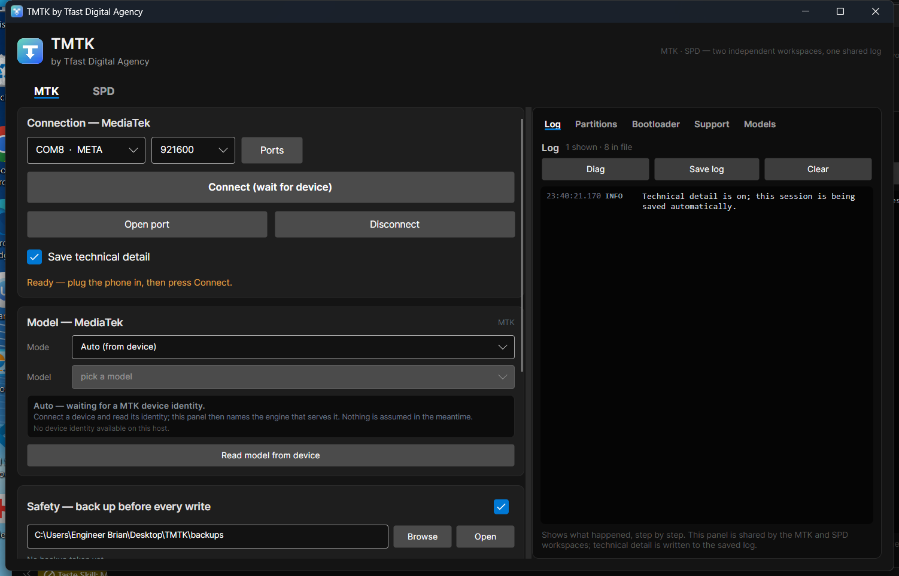 
      <b>MTK workspace</b> — META connect, model picker, backup-before-write, shared log
    </td>
    <td align="center" width="50%">
      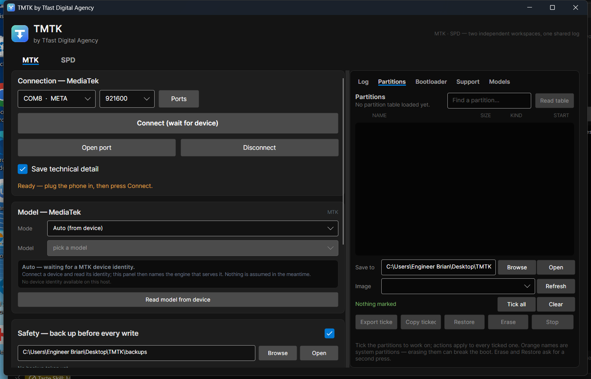 
      <b>Partitions</b> — read the table, tick rows, export / copy ticket / restore / erase
    </td>
  </tr>
  <tr>
    <td align="center" width="50%">
      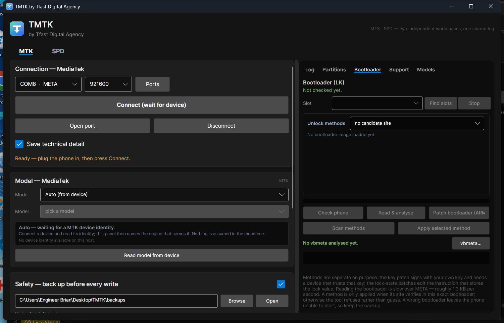 
      <b>Bootloader (LK)</b> — find slots, check phone, read &amp; analyse, scan methods, vbmeta
    </td>
    <td align="center" width="50%">
      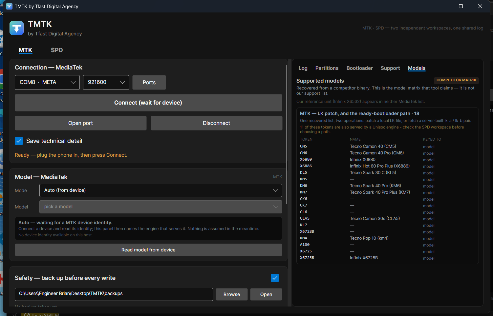 
      <b>MTK model matrix</b> — all 18 tokens, with the shared-engine warning on top
    </td>
  </tr>
  <tr>
    <td align="center" colspan="2" width="100%">
      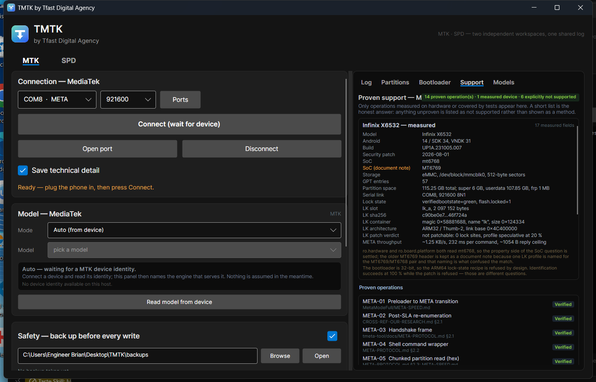 
      <b>Proven support</b> — 14 verified operations and one measured device, with the 6 explicitly
      unsupported items stated up front
    </td>
  </tr>
</table>

### 🟨 SPD engine

<table>
  <tr>
    <td align="center" width="50%">
      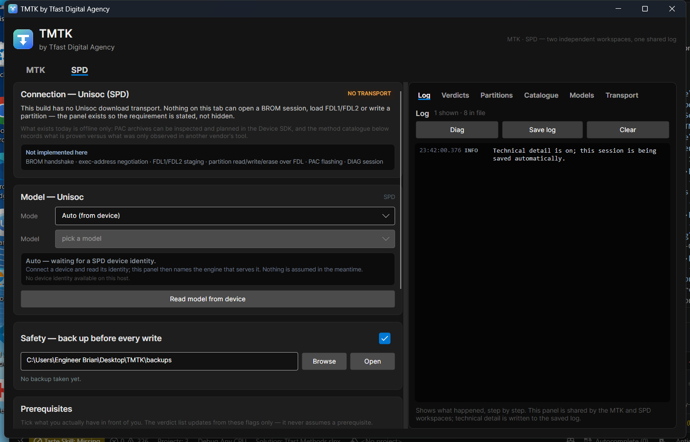 
      <b>SPD workspace</b> — the <code>NO TRANSPORT</code> badge is permanent, not a bug
    </td>
    <td align="center" width="50%">
      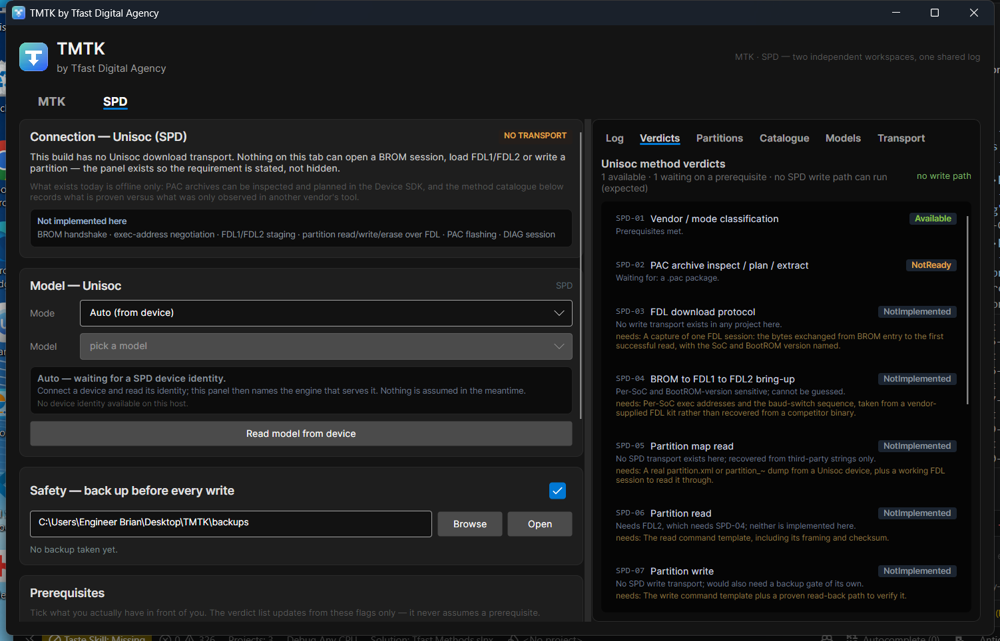 
      <b>Verdicts</b> — one available, one not ready, the rest NotImplemented with reasons
    </td>
  </tr>
  <tr>
    <td align="center" width="50%">
      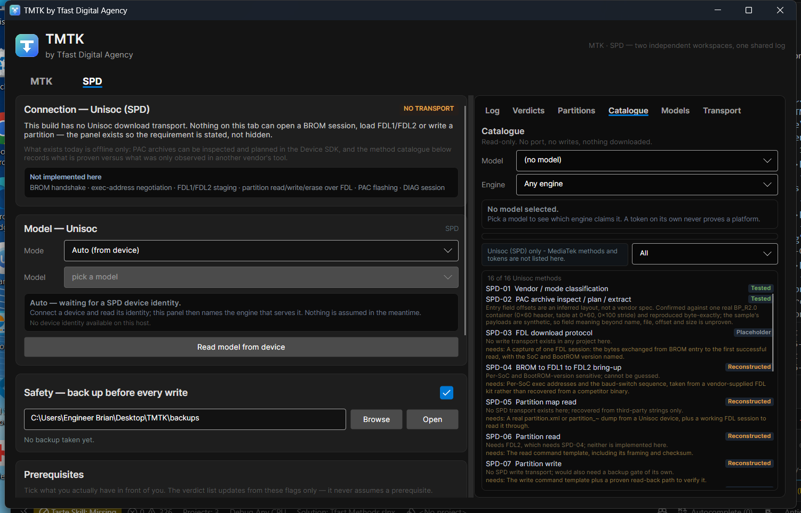 
      <b>Catalogue</b> — 16 of 16 Unisoc methods, each with its status tag and evidence line
    </td>
    <td align="center" width="50%">
      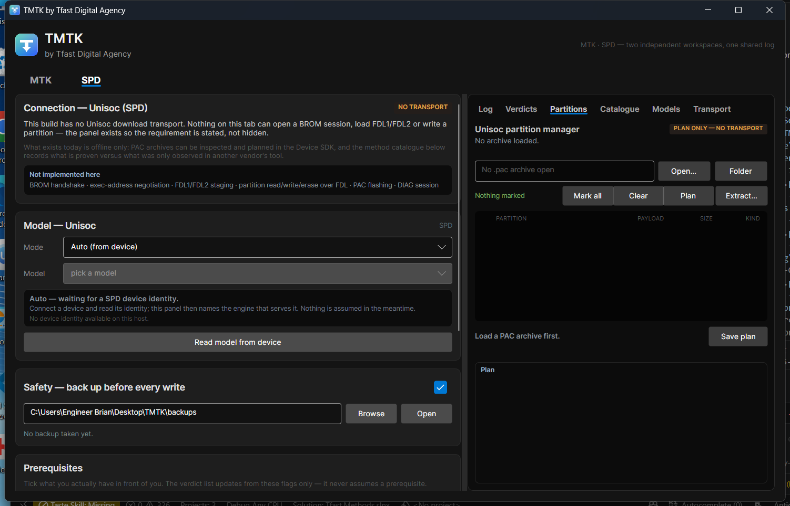 
      <b>Partition manager</b> — <code>PLAN ONLY — NO TRANSPORT</code>, PAC inspect / plan / extract
    </td>
  </tr>
  <tr>
    <td align="center" width="50%">
      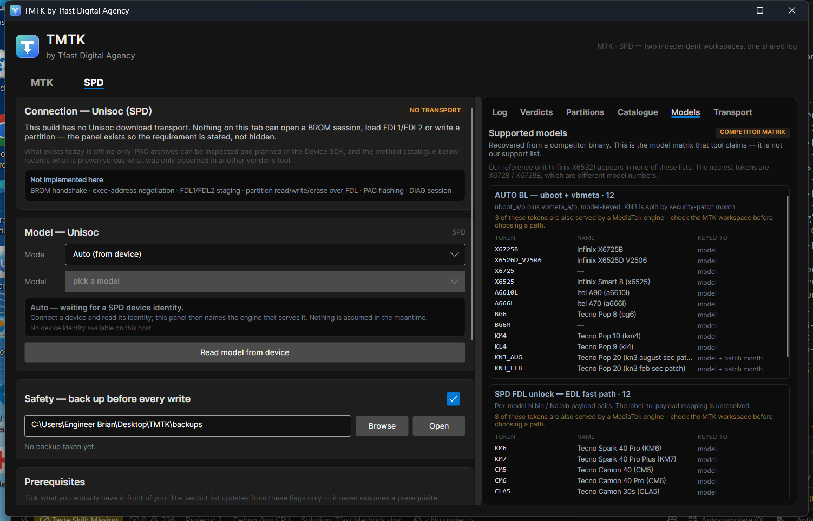 
      <b>SPD model matrix</b> — AUTO BL and FDL lists, with patch-month keying shown per row
    </td>
    <td align="center" width="50%">
      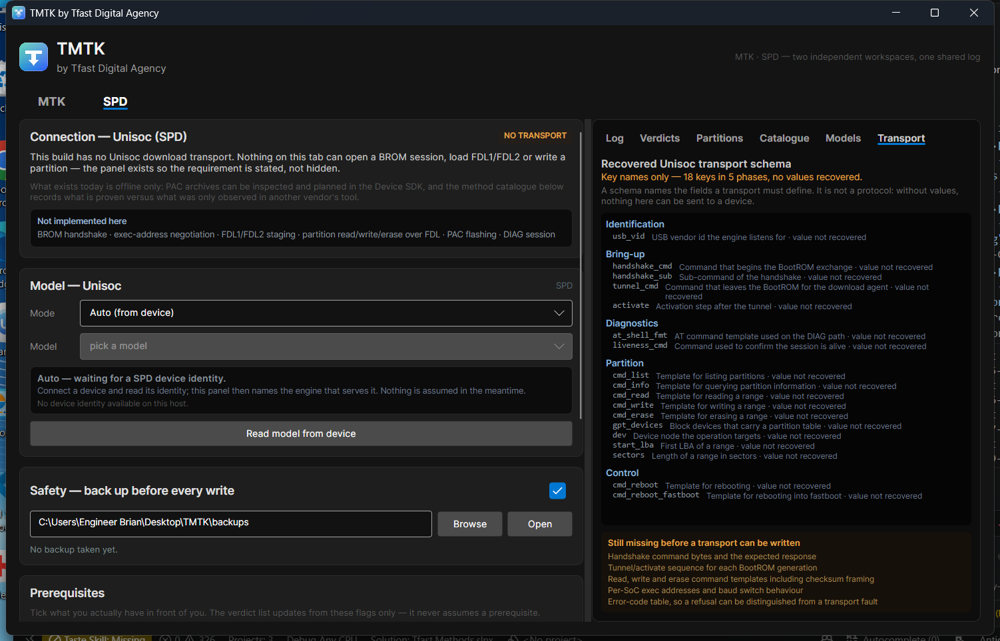 
      <b>Transport schema</b> — 18 key names recovered, <b>zero values</b>, and what is still missing
    </td>
  </tr>
</table>

> Nothing on these screens was staged. The `NO TRANSPORT` and `value not recovered` labels are the real
> output of the build, which is the point: the tool tells you what it cannot do.

Want to click through it instead of looking at stills? **[Open the demo shell →](demo/index.html)**

---

## 🗺️ Roadmap

| Area | State |
|---|---|
| MTK META channel, GPT, partition read/write | Working, verified byte-exact |
| MTK bootloader analysis + method selection | Working — and **refuses** on unsupported architectures |
| PAC `BP_R1` / `BP_R2` container handling | Working, reproduced byte-exactly |
| SPD offline lane (PAC, FDL kit, partition plan) | Working — **SPD is in active development** |
| Unisoc BROM → FDL1 → FDL2 transport | **In development** — needs a captured session or a vendor FDL kit |
| Unisoc partition map read/write | Next, once the transport lands |
| LK key patch (own signing key) | Implemented and byte-exact; **waits on certificate-chain re-encoding** |
| LK lock-state patch — ARM64 | Implemented: immediate rewrite, span check, read-back verify |
| LK lock-state patch — ARM32 | Implemented with an evidence-ranked candidate scan; **not hardware-validated** |

> The SPD engine is the part that is moving right now. Offline features ship as they are finished;
> anything not yet built is listed above rather than hidden. Honest progress notes:
> [`docs/FAQ.md`](docs/FAQ.md)

---

## 🤝 Support · model requests · business

| Channel | |
|---|---|
| 💬 WhatsApp | **[+256 751 399 620](https://wa.me/256751399620)** |
| 🌐 Website | **[tfastdigital.com](https://tfastdigital.com/)** |
| 📢 Telegram | **[t.me/tfasthub](https://t.me/tfasthub)** |

Missing your device in the matrix? Open a **Model request** issue with the model token, the SoC and
the security patch — that is exactly the data needed to key a new recipe.

---

## ⚖️ Disclaimer

TMTK is a professional service tool for **devices you own or are authorised to service**. Bootloader
unlocking, partition writing and firmware work can permanently brick a device and may void warranty or
breach a carrier/regional agreement. You are responsible for the device in front of you and for the law
where you operate. Read [`docs/DISCLAIMER.md`](docs/DISCLAIMER.md) before requesting access, and
[`LICENSE.md`](LICENSE.md) for the documentation terms.

TMTK v2.0 · TFAST Digital Agency · Documentation-only public repository

